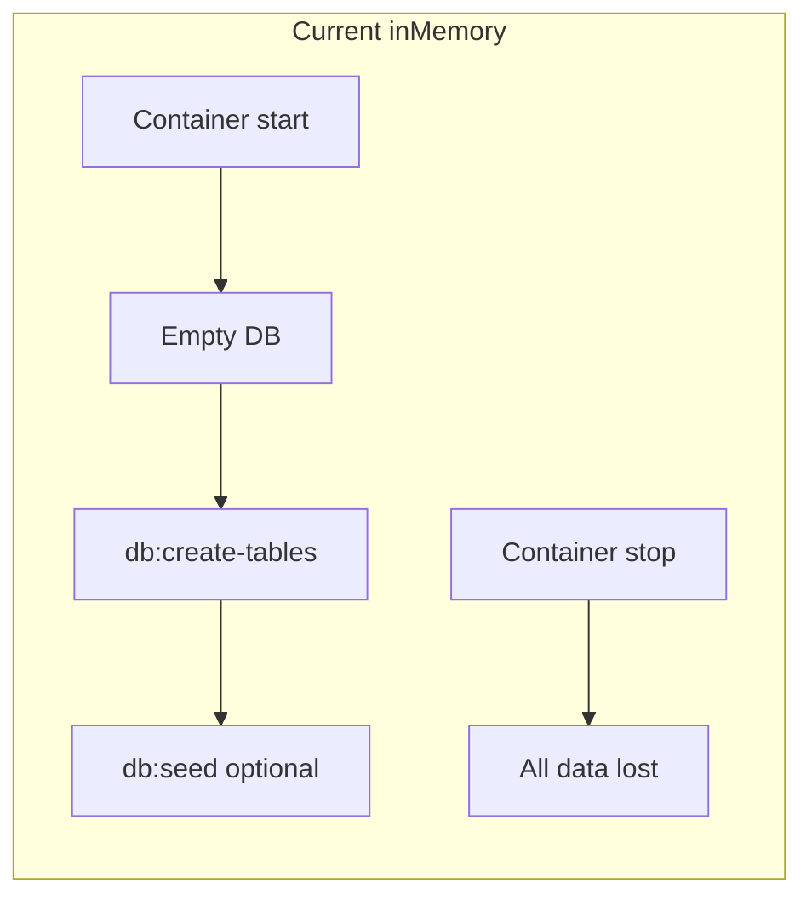
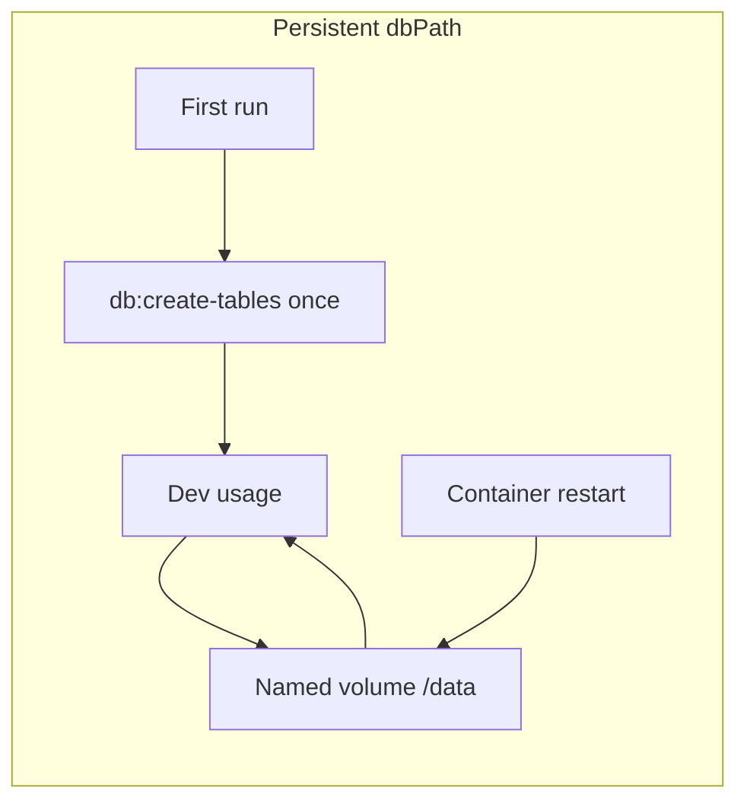

# Local DynamoDB Persistence

## Problem

`[docker-compose.yml](docker-compose.yml)` runs DynamoDB Local with `-inMemory`:

```yaml
command: ["-jar", "DynamoDBLocal.jar", "-sharedDb", "-inMemory"]
```

Every `docker compose` restart wipes all tables and rows. After reseed, only the **seed user** (`aaaaaaaa-aaaa-4aaa-8aaa-aaaaaaaaaaaa` from `[api/__data__/seed.constants.ts](api/__data__/seed.constants.ts)`) gets sample budgets.




## Target behavior




- Table definitions and all item data persist across `docker compose down` / `up`
- Cognito users keep profiles and events created via `upsertUserFromAuth` (`[api/src/auth/user.repository.ts](api/src/auth/user.repository.ts)`)
- Explicit wipe remains possible via `docker compose down -v`

## Implementation

### 1. Update DynamoDB service in `[docker-compose.yml](docker-compose.yml)`

Replace `-inMemory` with file storage:

```yaml
dynamodb:
  image: amazon/dynamodb-local:latest
  container_name: dynamodb
  restart: always
  ports:
    - "8000:8000"
  command: ["-jar", "DynamoDBLocal.jar", "-sharedDb", "-dbPath", "/data"]
  volumes:
    - dynamodb-data:/data

volumes:
  dynamodb-data:
```

Notes:

- **Do not** combine `-inMemory` and `-dbPath` (DynamoDB Local treats them as mutually exclusive).
- Keep `-sharedDb` so a single database file backs all local tables.
- Use a **named volume** (`dynamodb-data`) rather than a repo bind mount — avoids Windows permission/path issues and keeps data out of git.

### 2. Document the new workflow

Update `[readme.md](readme.md)` and `[api/README.md](api/README.md)`:


| Scenario                    | Command                                                                      |
| --------------------------- | ---------------------------------------------------------------------------- |
| First time / fresh volume   | `npm run db:create-tables -w node` then `npm run db:seed -w node` (optional) |
| Normal restart              | `./deploy.sh` or `docker compose up` — **no** re-seed required               |
| Wipe all local DB data      | `docker compose down -v` then recreate tables + optional seed                |
| Re-seed sample budgets only | `npm run db:seed:reset -w node` (still scoped to seed user)                  |


Add a short **"DynamoDB persistence"** subsection explaining:

- Data survives restarts; Cognito users retain their own events
- Seed data belongs to the dev user id, not your Cognito account
- `db:create-tables` is idempotent (`[ensureLocalTables](api/scripts/create-tables.ts)` skips if table exists)

### 3. Optional quality-of-life (low scope)

- **Healthcheck** on `dynamodb` (already noted in `[TODO.md](TODO.md)`) so `node` can `depends_on` with `condition: service_healthy` — reduces race where API starts before DynamoDB accepts connections.
- **No script changes required** — existing `db:create-tables`, `db:seed`, and `db:seed:reset` work unchanged against persistent storage.

### 4. Out of scope

- Auto-seeding on container start (keeps dev explicit and avoids overwriting Cognito user data)
- Bind-mounting `./.dynamodb` into the repo (named volume is sufficient)
- Production/CDK changes (AWS DynamoDB is already durable)

## Verification checklist

After implementation:

1. `docker compose down -v && ./deploy.sh` — clean slate
2. `npm run db:create-tables -w node` — table created
3. Sign in with Cognito, create a budget event
4. `docker compose restart dynamodb` (or full stack down/up **without** `-v`)
5. Confirm budget still appears on calendar and user profile exists
6. `docker compose down -v` — confirm data is gone on next start

## Files to change


| File                                       | Change                                           |
| ------------------------------------------ | ------------------------------------------------ |
| `[docker-compose.yml](docker-compose.yml)` | `-dbPath`, volume mount, `volumes` block         |
| `[readme.md](readme.md)`                   | Persistence docs, updated quick-start notes      |
| `[api/README.md](api/README.md)`           | Same persistence section for API-focused readers |
| `[TODO.md](TODO.md)` (optional)            | Mark local persistence item done if tracked      |


