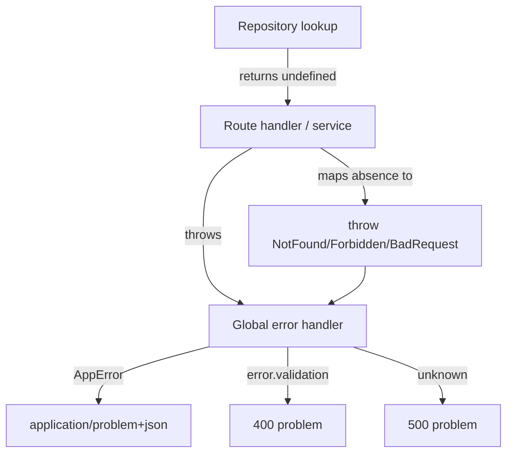

# Problem Details error contract and removal of `| null`

Scope: API only (`api/src`). Client is out of scope, but see Risks (response shape changes).

Strategy (confirmed): `| undefined` for genuine optional lookups; throw typed Problem Details errors only for true HTTP error conditions.

## 1. Error taxonomy — new `api/src/errors/http-error.ts`

Base `AppError extends Error` carrying RFC 9457 fields, plus fixed subclasses:

```ts
export abstract class AppError extends Error {
  abstract readonly status: number;
  abstract readonly title: string;
  readonly type: string = 'about:blank'; // or `/problems/<slug>`
  constructor(public readonly detail?: string) { super(detail); }
  toProblem(instance?: string) {
    return { type: this.type, title: this.title, status: this.status, ...(this.detail ? { detail: this.detail } : {}), ...(instance ? { instance } : {}) };
  }
}
```

Subclasses: `BadRequestError` (400), `UnauthorizedError` (401), `ForbiddenError` (403), `NotFoundError` (404), `ConflictError` (409), `BadGatewayError` (502), `ServiceUnavailableError` (503).

Reconcile the existing `ForbiddenError` in [api/src/auth/types.ts](api/src/auth/types.ts) (used by [cognito.ts](api/src/auth/cognito.ts), [oauth.ts](api/src/auth/oauth.ts), [entitlements.ts](api/src/billing/entitlements.ts)): re-define it in the errors module and re-export from `auth/types.ts` so existing imports keep working.

## 2. Problem Details schema — `api/src/swagger/schemas.ts`

Add:

```ts
export const problemDetailsSchema = Type.Object({
  type: Type.String({ default: 'about:blank' }),
  title: Type.String(),
  status: Type.Integer(),
  detail: Type.Optional(Type.String()),
  instance: Type.Optional(Type.String()),
}, { additionalProperties: true });
```

Replace `errorResponseSchema` usages (see step 6); keep it as a deprecated alias initially to avoid a big-bang.

## 3. Central error handler — new `api/src/errors/plugin.ts` (fastify-plugin)

One `app.setErrorHandler` + `app.setNotFoundHandler`, registered early in [api/src/app.ts](api/src/app.ts) (before routes). Mapping:
- `error instanceof AppError` -> `reply.status(error.status).type('application/problem+json').send(error.toProblem(request.url))`
- `error.validation` (TypeBox/Fastify) -> 400 problem, `title: 'Bad Request'`, `detail` summarized, optional `errors` extension.
- other `error.statusCode` -> problem with that status.
- fallback -> log, 500 `Internal Server Error` (no `detail` in production).

Remove the `setErrorHandler` currently in [api/src/auth/plugin.ts](api/src/auth/plugin.ts) (lines 10-18) to consolidate (Fastify keeps only one per context).



## 4. Replace generic throws with typed errors (request paths)

- [api/src/events/repository.ts](api/src/events/repository.ts): the 5 `throw new Error('Event not found')` (L138, L140, L164, L174, L221) -> `NotFoundError`.
- [api/src/events/update-event.ts](api/src/events/update-event.ts): `'Event is removed'` -> `NotFoundError`; `'Plaid transaction events cannot be updated'` and `'Only budget events can be updated'` -> `BadRequestError` (preserves the previous 400 behavior). `findEventById` already throws for not-found.
- [api/src/plaid/sync.service.ts](api/src/plaid/sync.service.ts) L151/L163: `'No linked Plaid item...'` -> `NotFoundError`; `'No linked bank accounts...'` -> `BadRequestError`. This lets us delete the fragile string-matching in the sync route.
- [api/src/billing/repository.ts](api/src/billing/repository.ts) L84: `throw new Error('User not found')` -> `NotFoundError` (note webhook caveat in Risks).

## 5. Remove `| null` from signatures -> `| undefined`

Genuine optionals (callers already use `if`/`??`), change return type and the `return ... : null` to `undefined`:
- [api/src/auth/user.repository.ts](api/src/auth/user.repository.ts) `findUserByCognitoSub` (L47/L60).
- [api/src/billing/repository.ts](api/src/billing/repository.ts) `findUserByStripeCustomerId` (L27/L37).
- [api/src/plaid/item.repository.ts](api/src/plaid/item.repository.ts) `findPlaidItemByPlaidItemId`.
- [api/src/plaid/sync-state.repository.ts](api/src/plaid/sync-state.repository.ts) `getItemKey`, `findSyncStateByItemId`.
- [api/src/dynamo/entities.ts](api/src/dynamo/entities.ts) `toPlaidSyncState`.
- [api/src/dynamo/keys.ts](api/src/dynamo/keys.ts) `parseEventSk`.
- [api/src/billing/constants.ts](api/src/billing/constants.ts) `priceIdToTier` (caller in [subscription.mapper.ts](api/src/billing/subscription.mapper.ts) already does `?? 'free'`).
- [api/src/auth/session.ts](api/src/auth/session.ts) `decryptSession` -> return `SessionPayload | undefined` and return `undefined` in the catch (must NOT throw: a bad cookie should become an empty session). Update the `onRequest` caller: `const payload = raw ? decryptSession(raw) : undefined; request.session = new RequestSession(payload ?? {});`

`findEventById` / `updateEventById` stay non-null (`Promise<EventWithId>`) since they now throw.

## 6. Simplify routes + swap response schemas

Convert inline `reply.status(n).send({ error, message })` to thrown typed errors so everything flows through the Problem Details handler, and swap `errorResponseSchema` -> `problemDetailsSchema` in every route `response` map.

- [api/src/events/routes.ts](api/src/events/routes.ts): `isValidId` failures -> `BadRequestError`; GET `/:id` remove the manual 404 (let `findEventById` throw; keep a removed-guard that throws `NotFoundError`); PATCH `/:id` drop the null / `"error" in result` branches (now `updateEventForUser` returns `EventWithId` or throws); create POST `/` rrule-or-frequency guard -> `BadRequestError`.
- [api/src/billing/routes.ts](api/src/billing/routes.ts): `!user` -> `ForbiddenError`; `!isStripeConfigured()` -> `ServiceUnavailableError`; portal `!user?.stripeCustomerId` -> `ForbiddenError`; checkout/portal catch -> map to `BadGatewayError`; webhook signature/body checks -> `BadRequestError` (keep the webhook try/catch so Stripe still gets a 400 rather than a client-facing problem).
- [api/src/plaid/routes.ts](api/src/plaid/routes.ts): exchange-token catch -> `BadGatewayError`; transactions/sync -> remove string-matching, rely on typed throws from `sync.service`.
- [api/src/auth/routes.ts](api/src/auth/routes.ts) L128 `401` -> `UnauthorizedError` (optional).
- Grep-and-replace remaining `errorResponseSchema` imports/usages (also check `categories/routes.ts`). Remove the export once unused.

## 7. Verify

`npm run build`/`tsc` in `api` (this should also clear the outstanding null-vs-signature type errors), then run the API test suite.

## Risks / call-outs

- Response shape change: error bodies move from `{ error, message }` to `{ type, title, status, detail, instance }`. Any client code reading `err.error` / `err.message` will break at runtime even though this is an API-only change. Verify/update client error handling as a coordinated follow-up.
- Webhook path: `updateSubscriptionByStripeCustomerId` throwing `NotFoundError` is fine only because the webhook route catches and returns 400 to Stripe (triggering retry). Do not let webhook-internal not-found become a client-facing 404.
- `decryptSession` must return `undefined` (not throw) for invalid cookies, or every request with a stale cookie 500s.
- OpenAPI docs will still advertise `application/json` for error responses unless we customize the media type; the runtime `Content-Type` will be `application/problem+json`. Cosmetic; can refine later.
- 500 fallbacks must not leak internal error messages in production.